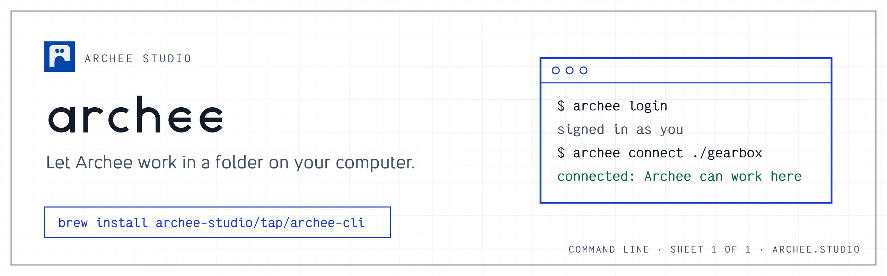

<picture>
  <source media="(prefers-color-scheme: dark)" srcset="assets/banner-dark.png">
  
</picture>

**Let Archee work in a folder on your computer** while you chat with it in the browser.

```sh
brew install archee-studio/tap/archee-cli    # or download from Releases
archee login
archee connect ./my-gearbox                  # Ctrl-C to stop
```

`archee whoami`, `archee logout` and `archee update` do what they say; every command takes `--json`. Windows is in beta.

`connect` is not a sandbox: commands Archee runs there act as you. Read [SECURITY.md](https://github.com/Archee-Studio/archee-cli/blob/main/SECURITY.md) before connecting a folder.

## For agents

```text
Read AGENTS.md in github.com/Archee-Studio/archee-cli. Then run `archee --json` and tell me the next step to connect this folder to Archee Studio.
```

## Licence

[Apache-2.0](https://github.com/Archee-Studio/archee-cli/blob/main/LICENSE). Published from the Archee Studio source; pull requests are reapplied upstream ([CONTRIBUTING.md](https://github.com/Archee-Studio/archee-cli/blob/main/CONTRIBUTING.md)).
